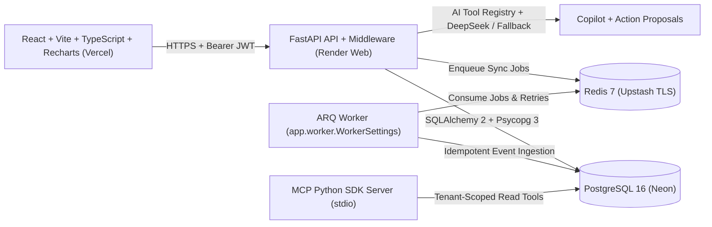

# PulseOps — AI-Native SaaS Operations Control Tower

[](https://github.com/SleepThief101/pulseops/actions/workflows/ci.yml)

**PulseOps** replaces fragmented weekly SaaS operations spreadsheets by unifying **MRR, churn, GitHub pull requests, open issues, and issue cycle time** into a multi-tenant control tower with encrypted connector storage, asynchronous ingestion, and a human-in-the-loop AI Copilot.

---

## Architecture



---

## Core Capabilities

- **Multi-Tenant Isolation & RBAC:** Organization-scoped tables (`organization_id`), `owner` / `member` / `viewer` permission hierarchy, `404` cross-tenant resource obscurity, Argon2id password hashing, and HS256 JWT authentication.
- **Connector & Idempotent Event Engine:** Abstract `BaseConnector` + `ConnectorRegistry`, normalized `Event` model (`uq_events_org_source_external_id`), and atomic PostgreSQL `ON CONFLICT DO NOTHING` ingestion.
- **Integrations, CSV & Webhooks:**
  - **Razorpay:** Test Mode (`rzp_test_*`) pagination + signed HMAC-SHA256 webhooks + **conditional mock-billing fallback** when Test Mode credentials are unavailable.
  - **GitHub:** Paginated REST PR/Issue ingestion with cycle-time computation, OAuth state verification, HMAC-SHA256 webhooks, plus mock mode for offline demos.
  - **CSV Imports:** Deterministic SHA-256 deduplication for spreadsheet migrations (`JSON` and `text/csv`).
- **Asynchronous Workers & Audit Trail:** `Redis 7 + ARQ` worker (`app.worker.WorkerSettings`) with retry backoff and `SyncRun` execution audit records.
- **Metrics Engine & Control Tower UI:** Real-time MRR, ARR, churn rate, PR throughput, open issues, and cycle time KPIs with interactive Recharts trend visualizations and event payload drilldowns.
- **AI Copilot, MCP Server & Human Approvals:** DeepSeek tool-calling (with zero-cost deterministic local fallback when `DEEPSEEK_API_KEY` is unset), MCP Python SDK server (`app.mcp_server`), and human-in-the-loop `ActionProposal` approvals before any mutating tool executes.
- **Observability:** Single-line structured JSON logging with validated `X-Request-ID` tracing and automatic credential redaction.

> [!NOTE]
> **Simulated & Fallback Modes:** In local development, CI, and demo environments without live external API credentials, PulseOps uses Razorpay mock-billing fallback (`mode: "mock"` / `RAZORPAY_MOCK_FALLBACK=true`), GitHub mock mode, `FakeConnector`, and the deterministic Copilot fallback. Live payment processing (`rzp_live_*`) is strictly blocked during development.

---

## Technology Stack

- **Backend:** Python 3.12, FastAPI, SQLAlchemy 2, Alembic, PostgreSQL 16, Psycopg 3, Redis 7, ARQ, Pydantic Settings, PyJWT, `pwdlib[argon2]`, `cryptography` (Fernet), `mcp`
- **Frontend:** React 18, TypeScript, Vite, Recharts, Vitest
- **Infrastructure & Quality:** Docker Compose, GitHub Actions, Ruff, Gitleaks, pytest

---

## Local Quickstart

1. **Copy environment template and set local secrets (never commit `.env`):**
   ```bash
   cp .env.example .env
   ```
   Ensure `.env` includes `CORS_ORIGINS=http://localhost:5173` for local Vite frontend requests, and generated keys for `JWT_SECRET_KEY` and `INTEGRATION_ENCRYPTION_KEY` (see [Secrets Runbook](./docs/deployment/secrets-and-encryption.md)).

2. **Start Backend Services (API, ARQ Worker, PostgreSQL 16, Redis 7):**
   ```bash
   docker compose up -d --build
   docker exec pulseops-api alembic upgrade head
   ```

3. **Start Frontend Dashboard:**
   ```bash
   cd frontend
   npm install
   npm run dev
   ```
   Open `http://localhost:5173` and create an organization workspace.

4. **Run Verification Suites:**
   ```bash
   # Backend tests (isolated to TEST_DATABASE_URL)
   docker exec pulseops-api pytest tests/ -v

   # Frontend tests & production build
   cd frontend && npm test && npm run build

   # Linting & secret scanning
   python -m ruff check .
   gitleaks detect --source . --no-banner --verbose
   ```

---

## Documentation Index

- [Deployment Guide (Vercel, Render, Neon, Upstash)](./docs/deployment/README.md)
- [Worker Operations, Monitoring & Recovery](./docs/deployment/worker-and-operations.md)
- [Environment Variable Matrix](./docs/deployment/environment-variables.md)
- [Encryption & Secret Management](./docs/deployment/secrets-and-encryption.md)
- [CI/CD & Production Audit](./docs/deployment/ci-cd-and-readiness.md)
- [Database & Isolation Architecture](./docs/database.md)
- [Authentication](./docs/authentication.md) · [Membership & RBAC](./docs/membership.md) · [Structured Logging](./docs/logging.md)
- [Demo Recording Script & Storyboard](./docs/demo-storyboard.md)
- [Pilot User Onboarding Checklist](./docs/pilot-onboarding.md)
- [Security Hardening Backlog](./docs/security-backlog.md)
