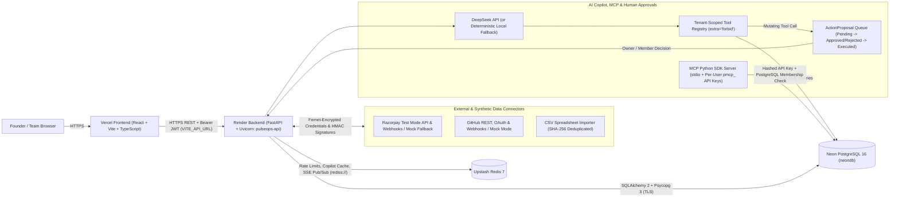

# PulseOps — AI-Native SaaS Operations Control Tower

[](https://github.com/SleepThief101/pulseops/actions/workflows/ci.yml)

**PulseOps** is a multi-tenant operations control tower for small SaaS teams. It replaces fragmented weekly spreadsheets tracking **MRR, ARR, churn, GitHub pull requests, open issues, and issue cycle time** with a unified control tower built on FastAPI, PostgreSQL 16, Redis 7, React/TypeScript, and a human-in-the-loop AI Copilot.

Live frontend deployment: `https://pulseops-two.vercel.app/` (API target configured at build time via `VITE_API_URL`).

---

## Problem PulseOps Solves

Early-stage SaaS founders and small engineering/ops teams typically assemble weekly health metrics by exporting payment/subscription spreadsheets, checking GitHub PR velocity manually, and reconciling open bugs across separate tabs. PulseOps consolidates billing events, repository activity, and CSV imports into a single normalized PostgreSQL event ledger scoped strictly by organization, backed by real-time metrics, encrypted connector storage, and an AI Copilot that never executes mutating actions without human approval.

---

## Architecture



> [!NOTE]
> **Asynchronous Worker Note:** An optional ARQ worker (`app.worker.WorkerSettings`) runs in local Docker Compose (`pulseops-worker`), while the Render background worker service is intentionally disabled in `render.yaml` to remain on free-tier hosting. Synchronous connector syncs (`POST /orgs/{org_id}/integrations/{integration_id}/sync`) handle all production ingestion directly.

---

## Core Capabilities

- **Metrics Engine & Control Tower UI:** Computes Net MRR, ARR, churn rate, active/churned subscribers, GitHub PR merges, open issue counts, and PR/issue cycle times across `7d`, `30d`, and `90d` windows, with interactive Recharts visualizations (`AreaChart` + `BarChart`), KPI card drilldowns, paginated event inspection, and RFC 4180 CSV export.
- **Multi-Tenant Isolation & RBAC:** Every tenant resource carries `organization_id`. Membership resolves strictly from PostgreSQL (`owner`, `member`, `viewer`), non-members receive HTTP `404` to avoid tenant enumeration, and cross-tenant boundaries are covered by automated regression tests.
- **Encrypted Connectors & Idempotent Ingestion:** Abstract `BaseConnector` + `ConnectorRegistry` supporting Razorpay Test Mode (`rzp_test_*` + mock fallback), GitHub REST/OAuth (`mock` + live token), CSV uploads (`POST /orgs/{org_id}/imports/csv`), and synthetic testing (`fake`). Events deduplicate atomically via `uq_events_org_source_external_id` (`ON CONFLICT DO NOTHING`).
- **Signed Webhooks:** `POST /webhooks/razorpay/{org_id}` and `/webhooks/github/{org_id}` enforce constant-time HMAC-SHA256 verification, replay timestamp windows, and persisted `webhook_deliveries` deduplication (`409` on replay).
- **AI Copilot & Human-in-the-Loop Approvals:** Integrates with DeepSeek (`DEEPSEEK_API_KEY`) using strict Pydantic `extra="forbid"` tool schemas and falls back seamlessly to deterministic local briefings when unconfigured. Mutating tools (`sync_organization_integration`, `disconnect_integration`) always create `ActionProposal` records awaiting human decision rather than auto-executing.
- **MCP Server (`stdio`):** Exposes tenant-scoped read-only tools via `app.mcp_server` authenticated exclusively with SHA-256 hashed per-user `pmcp_...` API keys (`/me/api-keys`). Network MCP transports remain disabled.
- **Observability & Hardening:** Single-line structured JSON logs with validated `X-Request-ID`, recursive secret redaction in logs and `AuditLog`, `/health`, `/readiness`, `/metrics` (Prometheus), and Redis fixed-window rate limits (`429` + `Retry-After`).

---

## Technology Stack

- **Backend:** Python 3.12, FastAPI, SQLAlchemy 2, Alembic, PostgreSQL 16 (`psycopg`), Redis 7, ARQ, Pydantic Settings, PyJWT, `pwdlib[argon2]`, `cryptography` (Fernet), `prometheus-client`, `mcp`
- **Frontend:** React 18, TypeScript, Vite, Recharts, Vitest
- **Infrastructure & Quality:** Vercel, Render, Neon, Upstash, Docker Compose, GitHub Actions, Ruff, Gitleaks, pytest

---

## Authentication and RBAC

- **Password & Token Security:** Passwords are hashed using Argon2id (`pwdlib`) and verified in constant time (dummy hash verified on unknown email). Sessions issue signed HS256 JWTs (`sub`, `iat`, `exp`, 1-hour expiry).
- **Registration & Workspaces:** `POST /auth/register` atomically creates a `User`, `Organization`, and `owner` `Membership`. Existing users can be added to an organization by an `owner` via `POST /orgs/{org_id}/members`.
- **Role Hierarchy (`owner` > `member` > `viewer`):**
  - `owner`: Manage credentials/integrations, invite members, inspect `AuditLog` (`/orgs/{org_id}/audit-logs`), manage Copilot proposals including `disconnect_integration`, and manage personal MCP API keys (`/me/api-keys`).
  - `member`: Trigger integration syncs, upload CSVs, propose sync actions, and approve/reject `sync_organization_integration` proposals.
  - `viewer`: Read-only access to dashboards, events, CSV exports, and read-only Copilot briefings.

---

## Integration Architecture

1. **Credential Storage:** Owners submit credentials (`mode: "mock"` or test credentials), which are encrypted via Fernet (`INTEGRATION_ENCRYPTION_KEY`) before persisting in `integrations.credentials_encrypted`. Responses never return secrets.
2. **Sync Execution:** Each sync records a `SyncRun` lifecycle (`pending`/`running` -> `completed`/`failed`) tracking `events_received`, `events_inserted`, `events_skipped`, and error diagnostics.
3. **CSV Imports & Exports:**
   - **Import:** `POST /orgs/{org_id}/imports/csv` accepts JSON `{"csv_text": "..."}` or raw `text/csv` (max 2 MB / 10,000 rows), requires `event_type` and `occurred_at`, generates deterministic `csv_<sha256>` external IDs when absent, and neutralizes formula prefixes (`=`, `+`, `-`, `@`).
   - **Export:** `GET /orgs/{org_id}/events/export` streams tenant-scoped RFC 4180 CSV downloads with formula-injection sanitization.

---

## AI Copilot & Human Approval Design

1. **Tool Registry (`app.ai.tool_registry`):** Separates read-only analytics tools (`get_metrics_summary`, `get_metrics_timeseries`, `list_recent_events`, `list_integrations_status`) from mutating tools (`sync_organization_integration` [`member`+], `disconnect_integration` [`owner`]).
2. **Central Execution Guard (`execute_tool_safely`):** Blocks mutating execution unless `allow_mutating_execution=True` during explicit proposal approval, forbids caller-supplied `organization_id` / `db` / `role` injection, and validates arguments strictly.
3. **Deterministic Fallback:** When `DEEPSEEK_API_KEY` is unset (or upstream fails), Copilot queries live organization metrics/integrations safely and generates `ActionProposal` records for authorized sync/disconnect prompts while declining unauthorized roles cleanly.
4. **Quota & Caching:** Responses are cached briefly in Redis per org/model/role and auto-invalidated on new event ingestion. Read-only `demo@pulseops.example.com` usage is capped via `DEMO_COPILOT_DAILY_LIMIT` (default `5` requests/UTC day).

---

## Local Development Setup

1. **Configure local environment variables (never commit `.env`):**
   ```bash
   cp .env.example .env
   cp frontend/.env.example frontend/.env
   ```
   Generate distinct local cryptographic secrets for `.env`:
   ```bash
   python -c "import secrets; print(secrets.token_hex(32))"
   python -c "from cryptography.fernet import Fernet; print(Fernet.generate_key().decode())"
   ```
   Set `JWT_SECRET_KEY`, `INTEGRATION_ENCRYPTION_KEY`, and `CORS_ORIGINS=http://localhost:5173`. Keep `RAZORPAY_MOCK_FALLBACK=true` and `DEEPSEEK_API_KEY` blank for zero-cost local development.

2. **Start PostgreSQL 16, Redis 7, FastAPI API, and ARQ Worker:**
   ```bash
   docker compose up -d --build
   docker exec pulseops-api alembic upgrade head
   ```

3. **Create the isolated local test database (first run only):**
   ```bash
   docker exec pulseops-db psql -U pulseops -d pulseops -c "CREATE DATABASE pulseops_test;"
   docker exec pulseops-api sh -c 'DATABASE_URL="$TEST_DATABASE_URL" alembic upgrade head'
   ```

4. **Start the React/Vite frontend:**
   ```bash
   cd frontend
   npm install
   npm run dev
   ```
   Open `http://localhost:5173`.

5. **Optional synthetic local demo seeding (guarded against test/remote DBs):**
   ```bash
   python scripts/seed_demo_data.py
   ```
   *(Refuses `pulseops_test` always and refuses `ENVIRONMENT=production` / non-local hosts unless `--allow-remote-target` is explicitly supplied.)*

---

## Environment Configuration (Placeholders Only)

| Variable | Component | Example / Placeholder | Notes |
| :--- | :--- | :--- | :--- |
| `ENVIRONMENT` | Backend | `development` / `production` | Enables fail-closed startup secret & CORS checks in production |
| `DATABASE_URL` | Backend | `postgresql+psycopg://<user>:<password>@<host>/<db>?sslmode=require` | Normalized automatically for Psycopg 3 |
| `TEST_DATABASE_URL` | Tests only | `postgresql+psycopg://<user>:<password>@127.0.0.1:5432/pulseops_test` | Isolated test DB; never points to production |
| `REDIS_URL` | Backend | `redis://redis:6379/0` or `rediss://default:<password>@<host>:6379` | Upstash requires TLS `rediss://` |
| `JWT_SECRET_KEY` | Backend | `<64-char-hex-secret>` | Must differ from encryption key |
| `INTEGRATION_ENCRYPTION_KEY` | Backend | `<44-char-base64-fernet-key>` | Encrypts `integrations.credentials_encrypted` |
| `CORS_ORIGINS` | Backend | `https://pulseops-two.vercel.app` | Exact origin(s); wildcard `*` blocked in production |
| `ENABLE_DOCS` | Backend | `false` in production / `true` locally | Controls `/docs`, `/redoc`, `/openapi.json` |
| `RAZORPAY_MOCK_FALLBACK` | Backend | `true` | Blocks `rzp_live_*` keys; Test Mode or synthetic fallback only |
| `DEEPSEEK_API_KEY` | Backend | `<optional-api-key>` | Leave unset for zero-cost deterministic fallback |
| `DEMO_COPILOT_DAILY_LIMIT` | Backend | `5` | Daily cap applied to `DEMO_ACCOUNT_EMAIL` |
| `VITE_API_URL` | Frontend | `https://<render-service>.onrender.com` | Public build-time API URL (never store secrets in `VITE_*`) |

---

## Testing Instructions

All backend tests run against `TEST_DATABASE_URL` inside rolled-back transactions and never touch development or production databases.

```bash
# Backend full pytest suite (inside Docker API + Redis + pulseops_test)
docker exec pulseops-api pytest -v

# Linting & Secret scanning (from repository root)
python -m ruff check .
gitleaks detect --source . --no-banner

# Frontend unit tests, TypeScript check, and production bundle
cd frontend
npm test
npm run build

# Live deployment read-only smoke test
python scripts/smoke_test.py --base-url https://<render-service>.onrender.com
```

---

## Deployment Architecture & Free-Tier Hosting Limitations

| Layer | Provider | Role |
| :--- | :--- | :--- |
| **Frontend** | Vercel (Hobby) | Serves static Vite bundle from `frontend/` (`dist/`) with SPA rewrites (`frontend/vercel.json`). |
| **Backend API** | Render (Free Web) | Runs `pulseops-api` via `render.yaml` (`uvicorn app.main:app`, health check `/health`). |
| **Database** | Neon PostgreSQL 16 | Serverless Postgres (`neondb`), migrated to Alembic head `849f79e737c6`. |
| **Redis** | Upstash Redis 7 | TLS (`rediss://`) store for rate limits, Copilot response cache, and `/readiness` verification. |

### Free-Tier Hosting & Known Limitations

- **Render Cold Starts:** The free web service sleeps after inactivity; the first request after idle periods can take 30–50 seconds. The frontend warms `/health` on login load, retries transient `502`/`503`/`504` `GET` hydration calls automatically, and preserves existing JWT sessions during transient wake-up failures.
- **Disabled Background Worker on Render:** `render.yaml` keeps the ARQ background worker commented out because continuous workers require a paid Render plan. Synchronous `POST /sync` executes directly on `pulseops-api` without needing a separate worker. If `background=true` is requested when Redis queueing fails, the API marks the `SyncRun` failed and returns `503` cleanly.
- **Simulated Integrations:** Production synthetic demo integrations operate in Razorpay Mock/Test Mode and GitHub Mock Mode, plus an explicit `fake` connector for deterministic end-to-end verification.
- **Rate-Limit Fail-Open:** If Redis is temporarily unreachable, `rate_limit.py` logs a warning and fails open so legitimate logins are not locked out, while `/readiness` accurately surfaces `503`.
- **Single-Key Credential Encryption:** Credential encryption uses a single `Fernet` key (zero-downtime `MultiFernet` rotation is tracked in [`docs/security-backlog.md`](./docs/security-backlog.md)).
- **Frontend Audit Note:** `npm audit --omit=dev` reports **0** production runtime vulnerabilities (`react`, `recharts`); 3 dev-only advisories exist in transitive test-runner packages (`@vitest/mocker` / `tinypool`), whose remediation requires a major `vitest` upgrade (`--force`).
- **Workspace Role Scope:** Registration creates a single workspace with `owner` access; multi-workspace organization creation for already-logged-in users is currently done via registration or `POST /orgs/{org_id}/members`.

---

## Synthetic Demo Accounts

The production `PulseOps Synthetic Demo` workspace is populated with synthetic SaaS billing, GitHub PR/issue, and CSV records for demonstration. Passwords are private and never stored in code or documentation.

| Email | Role | Capabilities in Demo Workspace |
| :--- | :--- | :--- |
| `demo-admin@pulseops.example.com` | `owner` | Full administrative access, integration config, member management, audit logs, and proposal approvals |
| `demo-ops@pulseops.example.com` | `member` | Trigger integration syncs, upload CSV imports, and approve/reject sync proposals |
| `demo@pulseops.example.com` | `viewer` | Read-only dashboards, events, CSV export, and read-only Copilot briefings (`5` requests/UTC day) |

---

## Additional Documentation

- [Deployment Guide](./docs/deployment/README.md) · [Environment Variables](./docs/deployment/environment-variables.md) · [Secrets & Encryption](./docs/deployment/secrets-and-encryption.md)
- [Worker & Operations Runbook](./docs/deployment/worker-and-operations.md) · [CI/CD & Readiness](./docs/deployment/ci-cd-and-readiness.md)
- [Database Architecture](./docs/database.md) · [Authentication](./docs/authentication.md) · [Membership & RBAC](./docs/membership.md) · [Logging](./docs/logging.md)
- [Demo Storyboard](./docs/demo-storyboard.md) · [Pilot Onboarding](./docs/pilot-onboarding.md) · [Security Backlog](./docs/security-backlog.md)
