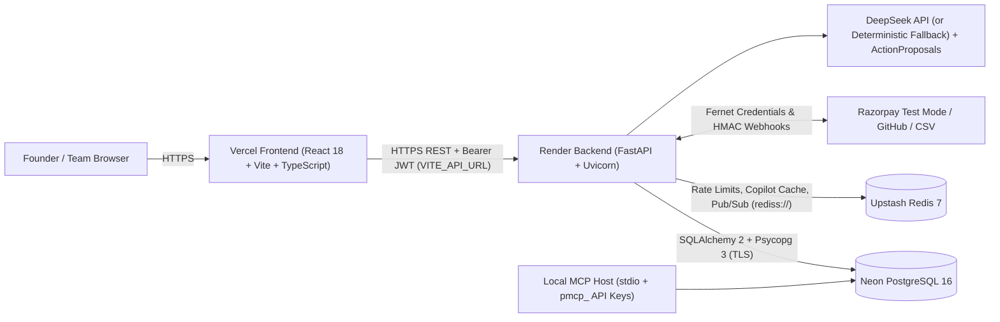

# PulseOps — AI-Native SaaS Operations Control Tower

[](https://github.com/SleepThief101/pulseops/actions/workflows/ci.yml)

**PulseOps** is a multi-tenant operations control tower for small SaaS teams. It replaces fragmented weekly spreadsheets tracking **MRR, ARR, churn, GitHub pull requests, open issues, and issue cycle time** with a unified control tower built on FastAPI, PostgreSQL 16, Redis 7, React/TypeScript, and a human-in-the-loop AI Copilot.

- **Live Frontend (Vercel):** `https://pulseops-two.vercel.app/`
- **Backend API (Render):** `https://pulseops-api-8cp9.onrender.com` *(Swagger UI disabled in production via `ENABLE_DOCS=false`)*

---

## Documentation Index

| Document | Audience & Purpose |
| :--- | :--- |
| **[Complete Product Documentation](./docs/PRODUCT_DOCUMENTATION.md)** | Central architecture, module reference, integrations, security, BCDR, Git maintenance, & roadmap |
| **[Production Readiness Audit](./docs/PRODUCTION_READINESS_AUDIT.md)** | 18-domain technical audit with evidence, severities, and P0–P3 remediation roadmap |
| **[Quick Start & Operations Guide](./docs/QUICK_START_AND_OPERATIONS.md)** | Practical Windows PowerShell commands for startup, migrations, tests, logs, & troubleshooting |
| **[Feature & API Inventory](./docs/FEATURE_AND_API_INVENTORY.md)** | Complete index of frontend pages, 32 API endpoints, 10 DB models, tools, migrations, & tests |

Additional reference guides: [External Integration Setup](./docs/EXTERNAL_INTEGRATION_SETUP.md) · [Deployment Guide](./docs/deployment/README.md) · [Environment Variables](./docs/deployment/environment-variables.md) · [Secrets & Encryption](./docs/deployment/secrets-and-encryption.md) · [Security Backlog](./docs/security-backlog.md)

---

## Main Capabilities

- **Multi-Currency Metrics Engine & Meridian Control Tower UI:** Calculates recurring Net MRR/ARR (separated from one-time `payment.captured` and failed charges), churn rate, active/churned subscribers, GitHub PR merges, open issue counts, and PR/issue cycle times across `7d`, `30d`, and `90d` windows, strictly partitioned by ISO-4217 currency (`by_currency`) with Recharts visualizations, event drilldowns, and RFC 4180 CSV export.
- **Multi-Tenant Isolation & RBAC:** Every tenant resource carries `organization_id`. Membership (`owner`, `member`, `viewer`) resolves strictly from PostgreSQL, non-members receive HTTP `404` to prevent tenant enumeration, and cross-tenant boundaries are verified by automated regression tests.
- **Encrypted Connectors & Idempotent Ingestion:** Supports Razorpay Test Mode (`rzp_test_*` + mock fallback, live keys blocked), GitHub REST/OAuth (`mock` + PAT), CSV uploads (2 MB / 10k rows max, formula-injection neutralized), and synthetic testing (`fake` + `is_synthetic` provenance separation). Events deduplicate atomically via `uq_events_org_source_external_id`.
- **Signed Webhooks:** `POST /webhooks/razorpay/{org_id}` and `/webhooks/github/{org_id}` enforce constant-time HMAC-SHA256 verification, replay timestamp tolerance, and persisted `webhook_deliveries` deduplication (`409` on replay).
- **AI Copilot, Human Approvals & MCP (`stdio`):** Integrates DeepSeek (`DEEPSEEK_API_KEY`) with deterministic local fallback, strict `extra="forbid"` Pydantic tool schemas, and `ActionProposal` human approvals for mutating tools (`sync_organization_integration`, `disconnect_integration`). Also exposes read-only `stdio` MCP tools authenticated with SHA-256 hashed per-user `pmcp_` API keys (`/me/api-keys`).
- **Observability & Hardening:** Single-line structured JSON logs with validated UUID `X-Request-ID`, recursive secret redaction in logs and `AuditLog`, `/health`, `/readiness`, `/metrics` (Prometheus), and Redis fixed-window rate limits (`429` + `Retry-After`).

---

## Architecture Summary



> [!NOTE]
> An optional ARQ worker (`app.worker.WorkerSettings`) runs in local Docker Compose (`pulseops-worker`), while the Render background worker is commented out in `render.yaml` to remain on free-tier hosting. Synchronous `POST /orgs/{org_id}/integrations/{integration_id}/sync` handles production syncs directly.

---

## Technology Stack

- **Backend:** Python 3.12, FastAPI, SQLAlchemy 2, Alembic (`9c4a12e8f3b1`), PostgreSQL 16 (`psycopg`), Redis 7, ARQ, Pydantic Settings, PyJWT, `pwdlib[argon2]`, `cryptography` (Fernet), `prometheus-client`, `mcp`
- **Frontend:** React 18, TypeScript, Vite 6, Recharts 2.15, Vitest 3
- **Infrastructure & Quality:** Vercel, Render, Neon, Upstash, Docker Compose, GitHub Actions, Ruff, Gitleaks, pytest

---

## Local Setup Overview

Full Windows 11 PowerShell instructions live in **[docs/QUICK_START_AND_OPERATIONS.md](./docs/QUICK_START_AND_OPERATIONS.md)** and **[docs/PRODUCT_DOCUMENTATION.md](./docs/PRODUCT_DOCUMENTATION.md#h-installation-and-local-development)**.

```powershell
# 1. Copy placeholder env files and generate local JWT & Fernet keys in .env (never commit .env)
Copy-Item .env.example .env
Copy-Item frontend\.env.example frontend\.env
python -c "import secrets; print(secrets.token_hex(32))"
python -c "from cryptography.fernet import Fernet; print(Fernet.generate_key().decode())"

# 2. Start Postgres, Redis, API (http://localhost:8000), and ARQ Worker
docker compose up -d --build
docker exec pulseops-api alembic upgrade head

# 3. Start Vite frontend (http://localhost:5173)
Set-Location frontend
npm install
npm run dev
```

*(Optionally create isolated `pulseops_test` and seed local synthetic demo accounts via `python scripts\seed_demo_data.py`; see [Quick Start](./docs/QUICK_START_AND_OPERATIONS.md#1-local-startup-docker-stack--local-frontend).)*

---

## Testing Instructions

All backend tests run inside rolled-back transactions against isolated `TEST_DATABASE_URL` (`pulseops_test`).

```powershell
# Backend test suite (202 pytest tests executed & passing during v1.3 verification; external HTTP connectors mocked)
docker exec pulseops-api pytest -v

# Secret scan & Ruff checks (from repo root)
gitleaks detect --source . --no-banner
python -m ruff check .

# Frontend unit tests (11 tests), TypeScript check & production build (from frontend\)
Set-Location frontend
npm test
npm run build

# Live read-only smoke test
python scripts\smoke_test.py --base-url https://pulseops-api-8cp9.onrender.com
```

---

## Project Status & Known Limitations

PulseOps (`v1.2` Meridian UI + `v1.3` Monetary Integrity & Copilot Grounding) is **feature-complete for portfolio demonstrations and controlled pilot walkthroughs** in Test/Mock mode, but **not yet hardened for real paying customers** (see [Production Readiness Audit](./docs/PRODUCTION_READINESS_AUDIT.md) for the full P0–P3 assessment):

- **Verified Production Migration & Schema:** Alembic revision `9c4a12e8f3b1` is applied and verified on production Neon PostgreSQL (`events.is_synthetic` and `events.minor_unit_exponent` columns confirmed, and post-migration Dashboard metrics & app verified).
- **Multi-Currency Product Limitation:** Currencies are aggregated strictly per currency under `by_currency` (`fx_conversion_applied=false`), preventing cross-currency addition; unified FX-converted totals remain unimplemented.
- **Test Mode & Mocked Integrations Policy:** Live Razorpay keys (`rzp_live_*`) are blocked by design; automated CI suites verify Razorpay, GitHub, and DeepSeek integrations using mocked HTTP responses rather than live external API calls.
- **Live Worker Infrastructure Limitation:** Render Free Web sleeps after inactivity (30–50s cold starts; handled by frontend `/health` wake ping and GET retries), and the background ARQ worker (`pulseops-worker`) is commented out in `render.yaml` so `?background=true` requires a paid worker.
- **Security, Auth & Compliance Gaps:** 1-hour JWTs in `localStorage` lack refresh/revocation, password reset, email verification, and explicit CSP headers; `/me/api-keys`, `/audit-logs`, `/events/stream` SSE, and GitHub OAuth callback lack frontend UI views; single-key `Fernet` (`MultiFernet` pending), unauthenticated `/metrics`, missing external alerting/tested restore drill, and absent Privacy Policy / Terms / GDPR deletion endpoints remain open.

### Synthetic Demo Workspace

The `PulseOps Synthetic Demo` workspace uses synthetic billing, GitHub, and CSV data (`is_synthetic=true`). Passwords are private and never stored in code or documentation.

| Email | Role | Capabilities in Demo Workspace |
| :--- | :--- | :--- |
| `demo-admin@pulseops.example.com` | `owner` | Full administrative access, integration config, member invites, audit logs, and proposal approvals |
| `demo-ops@pulseops.example.com` | `member` | Trigger integration syncs, upload CSV imports, and approve/reject sync proposals |
| `demo@pulseops.example.com` | `viewer` | Read-only dashboards, events, CSV export, and read-only Copilot briefings (`5` requests/UTC day) |
