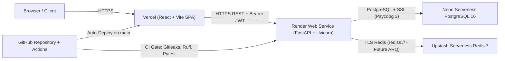

# PulseOps Production Deployment Guide

This guide covers the first production deployment of **PulseOps** across **Vercel** (frontend), **Render** (FastAPI backend), **Neon** (PostgreSQL 16), **Upstash** (Redis 7), and **GitHub Actions** (CI/CD).

> [!IMPORTANT]
> **Current Repository Scope:** PulseOps backend (`S05–S39`) and React/Vite/TypeScript frontend (`S22–S29`) are implemented locally, including Redis 7 + ARQ workers, SSE real-time updates, CSV export, audit logging, Prometheus `/metrics`, `/readiness`, rate limiting, and synthetic demo tooling. Follow Sections A–C to deploy to Vercel, Render, Neon, and Upstash once you are ready to provision cloud resources.

Related runbooks:
- [Complete Environment Variable Matrix](./environment-variables.md)
- [Encryption & Secret Management Runbook](./secrets-and-encryption.md)
- [Worker Operations, Monitoring & Recovery](./worker-and-operations.md)
- [CI/CD & Production Readiness Verification](./ci-cd-and-readiness.md)
- [Security Hardening Backlog](../security-backlog.md)

---

## A. Architecture and Service Responsibilities



| Provider | Component | Responsibility |
| :--- | :--- | :--- |
| **Vercel** | React / Vite / TypeScript SPA | Serves static frontend assets globally over HTTPS; calls Render API using `VITE_API_URL` (`frontend/vercel.json`). |
| **Render** | FastAPI + Uvicorn Web Service | Executes API endpoints (`/auth/*`, `/me`, `/orgs/*`, `/health`, `/readiness`, `/metrics`), enforces RBAC & tenant isolation, emits JSON logs, terminates proxy-forwarded HTTPS. |
| **Neon** | Managed PostgreSQL 16 | Stores `organizations`, `users`, `memberships`, `integrations`, `events`, `sync_runs`, `action_proposals`, `audit_logs`, `api_keys`, `webhook_deliveries`, and `alembic_version`. Enforces TLS (`sslmode=require`) and point-in-time recovery. |
| **Upstash** | Managed Redis 7 | Configured via `REDIS_URL` (`rediss://`) for ARQ background job queues, SSE Pub/Sub (`events/stream`), Copilot response caching, and HTTP `429` rate limiting. |
| **GitHub** | Source Control & Actions CI | Hosts `main` branch; runs `.github/workflows/ci.yml` (Gitleaks, Ruff, Alembic migrations, isolated pytest suite) on pushes and pull requests. |

---

## B. Exact Environment Variable Configuration per Provider

### 1. Render (Backend Web Service — `pulseops-api`)

Configure these in **Render Dashboard -> Service -> Environment** (never commit real values):

| Key | Value / Format | Notes |
| :--- | :--- | :--- |
| `PYTHON_VERSION` | `3.12.8` | Pins Python 3.12 on Render native runtime |
| `ENVIRONMENT` | `production` | Enables fail-closed startup secret checks & disables Swagger UI |
| `LOG_LEVEL` | `INFO` | Controls `setup_logging` verbosity |
| `ENABLE_DOCS` | `false` | Keeps `/docs`, `/redoc`, `/openapi.json` disabled in production |
| `DATABASE_URL` | `postgresql+psycopg://<user>:<pass>@<neon-host>/<db>?sslmode=require` | Copied from Neon dashboard (`+psycopg` recommended; `postgresql://` is also normalized automatically) |
| `REDIS_URL` | `rediss://default:<pass>@<upstash-host>:6379` | Must use `rediss://` (TLS) for Upstash |
| `JWT_SECRET_KEY` | `<64-char hex string>` | Independent signing key (`secrets.token_hex(32)`) |
| `INTEGRATION_ENCRYPTION_KEY` | `<44-char base64 Fernet key>` | Independent encryption key (`Fernet.generate_key().decode()`) |
| `CORS_ORIGINS` | `https://<your-app>.vercel.app` | Comma-separated exact HTTPS frontend origin(s); wildcard `*` is rejected in production |

*(Do **not** set `TEST_DATABASE_URL` in production — it is strictly for local/CI isolated testing.)*

### 2. Vercel (Frontend — Once Implemented)

Configure in **Vercel Project -> Settings -> Environment Variables** (Production & Preview):

| Key | Value / Format | Notes |
| :--- | :--- | :--- |
| `VITE_API_URL` | `https://<your-service>.onrender.com` | Public base URL of the Render FastAPI backend (no trailing slash). **Never** store backend secrets (`JWT_SECRET_KEY`, `DATABASE_URL`, `INTEGRATION_ENCRYPTION_KEY`) in Vercel. |

### 3. Neon & Upstash

Neon and Upstash generate connection credentials (`DATABASE_URL`, `REDIS_URL`) in their respective dashboards, which you paste into **Render** environment variables.

---

## C. Step-by-Step Deployment Sequence

### Step 1: Provision Neon PostgreSQL

1. Create a new project in Neon (region matched as closely as possible to your Render region, e.g., `us-east-1` or `eu-central-1`, PostgreSQL **16**).
2. Copy the **Pooled** connection string (recommended for Render web traffic) and **Direct** connection string (recommended for running `alembic upgrade head`).
3. Verify SSL is enabled (`?sslmode=require` at the end of the URL).
4. Optional: Format the scheme as `postgresql+psycopg://` (the backend also normalizes `postgresql://` and `postgres://` automatically via `normalize_database_url`).

### Step 2: Provision Upstash Redis

1. Create a Serverless Redis database in Upstash in the same region as Render/Neon.
2. Enable **TLS (SSL)**.
3. Copy the TLS Redis URL starting with `rediss://default:<password>@<endpoint>:6379`.

### Step 3: Configure Render Backend

You can either deploy using the repository's [`render.yaml`](../../render.yaml) Blueprint or create a **Web Service** manually in Render:

- **Root Directory:** `backend`
- **Runtime:** `Python 3` (with `PYTHON_VERSION=3.12.8`)
- **Build Command:**
  ```bash
  pip install -r requirements.txt
  ```
- **Start Command:**
  ```bash
  uvicorn app.main:app --host 0.0.0.0 --port $PORT --proxy-headers --forwarded-allow-ips=*
  ```
- **Health Check Path:** `/health`

### Step 4: Set Production Secrets

Follow the [Encryption & Secret Management Runbook](./secrets-and-encryption.md) to generate two independent keys locally (`JWT_SECRET_KEY` and `INTEGRATION_ENCRYPTION_KEY`), save them in Render's Environment settings, and back up `INTEGRATION_ENCRYPTION_KEY` in an encrypted password manager / vault.

Add `ENVIRONMENT=production`, `ENABLE_DOCS=false`, `LOG_LEVEL=INFO`, `DATABASE_URL`, `REDIS_URL`, and temporary or target `CORS_ORIGINS`.

### Step 5: Run Alembic Migrations

Before routing user traffic, apply the schema to Neon using the **Direct** (non-pooled) Neon connection string from your local terminal (or Render Shell / `preDeployCommand` on paid plans):

```bash
cd backend
# PowerShell:
$env:DATABASE_URL="postgresql+psycopg://<user>:<pass>@<neon-direct-host>/<db>?sslmode=require"
$env:REDIS_URL="rediss://default:<pass>@<upstash-host>:6379"
alembic upgrade head
alembic current
```

Expected output shows revision `849f79e737c6 (head)`.

> [!WARNING]
> Never set `TEST_DATABASE_URL` to your Neon production URL or run `pytest` against Neon.

### Step 6: Deploy Vercel Frontend

The React/Vite/TypeScript application lives in `frontend/` (with [`frontend/vercel.json`](../../frontend/vercel.json) SPA routing):
1. Import the GitHub repository in Vercel and set **Root Directory** to `frontend`.
2. Framework Preset: **Vite**.
3. Build Command: `npm run build` (or `pnpm build`), Output Directory: `dist`.
4. Set `VITE_API_URL=https://<your-render-service>.onrender.com`.
5. Deploy and note the assigned production domain (e.g., `https://pulseops.vercel.app`).

### Step 7: Configure CORS and Production API URL

1. In **Render -> Environment**, set `CORS_ORIGINS` to your exact Vercel domain(s), e.g.:
   ```text
   https://pulseops.vercel.app
   ```
   *(If supporting custom domain + Vercel domain, separate with commas: `https://app.pulseops.dev,https://pulseops.vercel.app`. Never use `*`.)*
2. Trigger a Render redeploy/restart so the updated `CORS_ORIGINS` takes effect.

### Step 8: Verify Health, Registration, Login, and Organization Access

Run these smoke checks against your deployed Render API URL (`API_URL="https://<your-service>.onrender.com"`):

```bash
# 1. Root & Health Check (expect HTTP 200 {"status": "ok"} + X-Request-ID header)
curl -i "$API_URL/health"

# 2. Verify docs are disabled in production (expect HTTP 404)
curl -i "$API_URL/docs"

# 3. Register test smoke account (expect HTTP 201 + organization_id)
curl -i -X POST "$API_URL/auth/register" \
  -H "Content-Type: application/json" \
  -d '{"email":"smoke_verify@example.com","password":"StrongSmokePassword1!","organization_name":"Smoke Check Org"}'

# 4. Login (expect HTTP 200 + access_token)
curl -s -X POST "$API_URL/auth/login" \
  -H "Content-Type: application/json" \
  -d '{"email":"smoke_verify@example.com","password":"StrongSmokePassword1!"}'

# 5. Authenticated /me & /orgs/{org_id}/members (expect HTTP 200)
curl -i "$API_URL/me" -H "Authorization: Bearer <ACCESS_TOKEN>"
curl -i "$API_URL/orgs/<ORG_ID>/members" -H "Authorization: Bearer <ACCESS_TOKEN>"
```

Check Render Logs to confirm single-line JSON output containing `request_id`, `http_method`, `path`, `status_code`, `duration_ms`, and `user_id` — with zero passwords or Bearer tokens logged.

---

## D. Database Backup and Recovery Procedure

1. **Neon Automated Backups / Point-in-Time Recovery (PITR):**
   - Neon continuously stores write-ahead logs (WAL) supporting instant branch creation from any point within your plan's restore window.
   - To restore without overwriting live data prematurely: create a **Neon Branch** from a timestamp prior to the incident, verify data in the branch, and either promote/swap or export rows.
2. **Manual Logical Backup (`pg_dump`):**
   ```bash
   pg_dump "postgresql://<user>:<pass>@<neon-direct-host>/<db>?sslmode=require" \
     --format=custom --no-owner --no-acl --file="pulseops_backup_$(date +%Y%m%d_%H%M%S).dump"
   ```
3. **Manual Restore (`pg_restore`):**
   ```bash
   pg_restore --clean --if-exists --no-owner --no-acl \
     --dbname="postgresql://<user>:<pass>@<target-host>/<db>?sslmode=require" \
     pulseops_backup_YYYYMMDD_HHMMSS.dump
   ```
4. **Key Dependency:** Database backups contain `integrations.credentials_encrypted` ciphertext. Always store `INTEGRATION_ENCRYPTION_KEY` backups separately from database dumps.

---

## E. Application Rollback Procedure

1. **Backend Code Rollback (Render):**
   - Open **Render Dashboard -> Service -> Events / Deploys**.
   - Select the last known healthy deploy and click **Rollback to this deploy**.
   - Verify `GET /health` returns HTTP `200` and review Render JSON logs.
2. **Frontend Rollback (Vercel):**
   - Open **Vercel Dashboard -> Deployments**.
   - Click the menu (`...`) on the previous healthy production deployment and choose **Instant Rollback**.
3. **Database Migration Rollback (Alembic):**
   - Prefer **forward-fix migrations** over downgrades when data has already been written.
   - Only run `alembic downgrade -1` against production if you have verified the `downgrade()` path is non-destructive (or after taking a Neon branch / `pg_dump` snapshot):
     ```bash
     cd backend
     alembic downgrade -1
     ```

---

## F. Troubleshooting Common Deployment Failures

| Symptom | Root Cause | Fix |
| :--- | :--- | :--- |
| `RuntimeError: JWT_SECRET_KEY must be set to at least 32 characters in production` | Missing or short `JWT_SECRET_KEY` when `ENVIRONMENT=production` | Generate 64-char hex secret via `secrets.token_hex(32)` and set in Render |
| `ModuleNotFoundError: No module named 'psycopg2'` | Unnormalized `postgresql://` URL with older SQLAlchemy / manual engine | Ensure `DATABASE_URL` uses `postgresql+psycopg://` (also auto-normalized in `config.py`) |
| `SSL SYSCALL error` or `SSL connection is required` on Neon | Missing `?sslmode=require` or idle Neon compute wake-up | Append `?sslmode=require` to `DATABASE_URL`; `pool_pre_ping=True` & `pool_recycle=300` handle idle suspends |
| `alembic upgrade head` hangs on Neon PgBouncer | Running DDL migrations against `-pooler` endpoint | Run Alembic against Neon's **direct** (non-pooled) connection string |
| Upstash connection errors or timeouts | Using `redis://` instead of `rediss://` | Change scheme to `rediss://` in `REDIS_URL` |
| Render health check timeout / bad gateway | Start command not binding `0.0.0.0:$PORT` or Python version mismatch | Use `--host 0.0.0.0 --port $PORT` and set `PYTHON_VERSION=3.12.8` |
| Browser CORS errors calling Render from Vercel | Missing `CORS_ORIGINS` or trailing slash mismatch | Set exact origin (e.g. `https://pulseops.vercel.app`) without trailing slash |
| `401 Unauthorized` across all tokens after redeploy | `JWT_SECRET_KEY` was changed or misconfigured | Restore intended `JWT_SECRET_KEY` or ask users to log in again |

---

## G. Production Security Checklist

- [ ] `ENVIRONMENT=production` and `ENABLE_DOCS=false` verified (`/docs` returns `404`).
- [ ] `JWT_SECRET_KEY` is at least 32 random bytes (`secrets.token_hex(32)`), unique to production.
- [ ] `INTEGRATION_ENCRYPTION_KEY` is a valid Fernet key, distinct from `JWT_SECRET_KEY`, and backed up offline.
- [ ] `DATABASE_URL` enforces `sslmode=require`; `REDIS_URL` enforces `rediss://`.
- [ ] `CORS_ORIGINS` lists only exact HTTPS production frontend origin(s) — never `*`.
- [ ] `TEST_DATABASE_URL` is **not** configured in production.
- [ ] `.env` is untracked (`.gitignore`), excluded from Docker builds (`.dockerignore`), and CI Gitleaks scan passes cleanly.
- [ ] Uvicorn runs with `--proxy-headers --forwarded-allow-ips=*` behind Render TLS termination and without `--reload`.
- [ ] Structured JSON logs verified to exclude passwords, Bearer tokens, and DB credentials.

---

## H. Estimated Recurring Cost Categories

Do not rely on static prices here—check each provider's official pricing page before upgrading beyond free tiers:

| Provider | Cost Category & Tier Considerations | Pricing Page to Check |
| :--- | :--- | :--- |
| **Vercel** | Hobby (free for personal/portfolio projects) vs. Pro (commercial/team seats, bandwidth, build minutes). | `vercel.com/pricing` |
| **Render** | Free Web Service (spins down after inactivity, cold starts) vs. Starter/Standard paid instance (always-on, zero-downtime deploys, `preDeployCommand` support, RAM/CPU). | `render.com/pricing` |
| **Neon** | Free tier (compute hours/month, storage limit, branching limits) vs. Launch/Scale usage-based compute & storage. | `neon.tech/pricing` |
| **Upstash** | Free tier (daily command & bandwidth caps) vs. Pay-as-you-go / Fixed plans per 100K commands & storage. | `upstash.com/pricing` |
| **GitHub** | Free for public repos (unlimited CI minutes) or private repo included minutes; Gitleaks action licensing on GitHub Organization accounts. | `github.com/pricing` |
